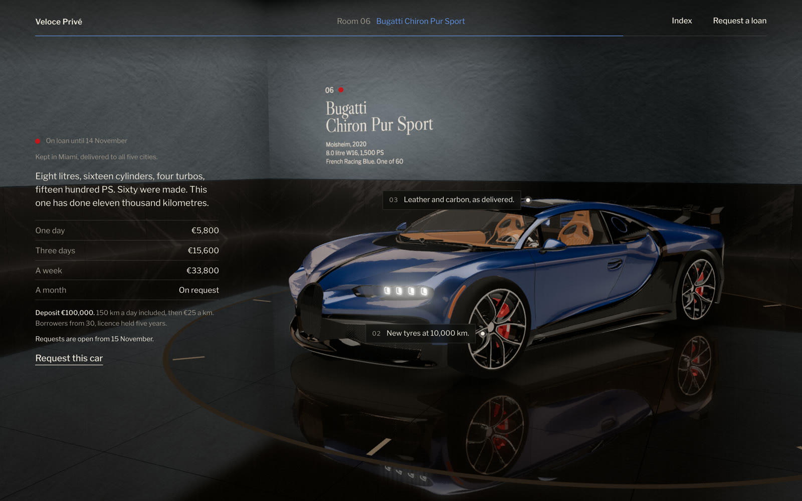

# Veloce Privé

A landing page for a private car collection that lends its cars by the day. You walk it with the scroll: from a dark hall where the house's name is cut into the wall, through six rooms, one car in each, to a desk where you request a loan.

**Live: [sam1983aing.github.io/veloce-prive](https://sam1983aing.github.io/veloce-prive/)**

## What happens as you scroll

- The hall opens in the dark. A slot of light in the floor strikes, its light climbs the wall and finds the carved name, then the rooms light one after another down the enfilade.
- Each room is lined in its car's home town: Maranello plaster, Stuttgart concrete, Sant'Agata hexagons and stone, a white room for the Senna, black stone under blue plaster for the Chiron.
- A car's turntable starts turning as you step into its room. Its condition report is pinned to the car, a note for each side as it comes round.
- Every room has the car's rates for a day, three days, a week and a month. Then the conditions of loan, the list of works, and a request form that prices your dates as you choose them.

## Notes

- This repository holds the built site only: the page, one minified script and stylesheet, and the 3D models it loads. The source isn't published.
- It needs WebGL and loads about 22 MB of models, the first car first, the rest in the order you walk past them. Best on a desktop browser; it works on recent phones.
- Fonts come from Google Fonts.

## Credits

Car models, repainted and adjusted for this page:

- [Ferrari 458](https://threejs.org/examples/#webgl_materials_car) by vicent091036, from the three.js examples
- [Porsche 911 Carrera 4S](https://sketchfab.com/3d-models/free-porsche-911-carrera-4s-d01b254483794de3819786d93e0e1ebf) by [Lionsharp Studios](https://sketchfab.com/lionsharp), [CC BY-SA 4.0](https://creativecommons.org/licenses/by-sa/4.0/)
- [Lamborghini Aventador](https://github.com/moizahmad418/aventador-3d-configurator) from moizahmad418's Aventador configurator
- [Lamborghini Gallardo](https://sketchfab.com/3d-models/lamborghini-gallardo-2010-ff0eb2242d0e42eb8b7034b4db639e56) by [Artem P](https://sketchfab.com/temp0.crazy), [CC BY 4.0](https://creativecommons.org/licenses/by/4.0/)
- [McLaren Senna](https://sketchfab.com/3d-models/mclaren-senna-free-ea3e43a6eb004853a87fe9c58422eb96) by [Black Snow](https://sketchfab.com/BlackSnow02), [CC BY 4.0](https://creativecommons.org/licenses/by/4.0/)
- [Bugatti](https://sketchfab.com/3d-models/bugatti-veyron-racing-car-unityunreal-8517e3271613487ca1cb37832ff54669) by [DevPoly3D](https://sketchfab.com/DevPoly3D), [CC BY 4.0](https://creativecommons.org/licenses/by/4.0/)

Veloce Privé is an invented house. The car makes and model names belong to their owners, and the page isn't affiliated with any of them.

All rights reserved.

---

Imported from [Sam1983Aing/veloce-prive](https://github.com/Sam1983Aing/veloce-prive) — original code and attribution preserved.
